# Contoso Health Identity Platform

**A Microsoft Entra ID IAM / PAM platform as code, tested offline and on local harnesses; tenant run pending.**
Michael Williams · IAM Analyst — Identity Security & Privileged Access Management · Microsoft SC-300



Contoso Health is a fictional ~5,000-person hospital group. It is hybrid (on-prem
AD plus Entra ID), regulated (HIPAA, SOX) and has just acquired a clinic that
runs on Okta. Clinicians cannot be locked out of patient care, so every control
here is designed around that constraint. This repository is the identity
platform for that scenario, and it follows one employee, Dana Okafor, from hire
to departure.

A narrated walkthrough will be recorded after the tenant run and linked here.

> **Status (2026-10-21): nothing has run against a Microsoft tenant yet** - no
> tenant exists. Every tenant feature sits behind a staging flag that defaults
> to off, and anything only a live tenant can confirm is marked `verify:` in
> the code. What has run, on the author's machine on 2026-10-20 and 21 (UTC):
>
> - **Offline checks (the evidence for BUILT):** `terraform validate` passes
>   in all 18 Terraform directories, and 325 mocked `terraform test` runs pass
>   across all 18 (302 in the Entra / Azure / AWS roots and modules, 23 in
>   the three Kubernetes roots). The lab's Pester suite passes 917 tests
>   with every Graph call mocked, and the ITDR suite 284. PSScriptAnalyzer
>   reports 0 errors, `shellcheck -x` reports no findings on all 41 shell
>   scripts, actionlint is clean on all 6 workflows, and Checkov reports 0
>   failed checks (each accepted finding is skipped inline, with its reason,
>   on the resource).
> - **Local harnesses (RAN · harness):** one runner (`lab/pam/test/run-all.sh`,
>   run `20261021T000019Z`) ran eight PAM suites: 610 checks passed, 0
>   failed, 1 skipped. 498 of them ran end to end in Docker: the PAM flow against a Samba AD
>   domain controller (284/284, including Tier-0 dual control and a recorded RDP
>   session to a Linux xrdp stand-in for the domain controller), the midPoint
>   certification campaign (91/91), dynamic database credentials (60/60) and the
>   Vault audit feed for the PAM anomaly detection (63 passed, 1 skipped: no
>   local Splunk). The other 112 are offline unit and fixture tests: dual
>   control against a local ServiceNow mock (45), the session-recording format
>   check (29), the audit ingest script (30) and the dependency-scan matching
>   logic (8; the scan itself has never run on a Windows host). The optional
>   `--scale` suite put 500 synthetic privileged accounts through the same
>   discovery, onboarding, rotation and reconciliation scripts (79/79, GAP
>   0). The Kubernetes segment passed 12/12 pipeline stages and 64/64
>   end-to-end checks on a throwaway kind cluster. The 22 KQL detections ran
>   on the Azure Data Explorer Kusto emulator, a local KQL engine, against
>   synthetic tables and events: 22/22 rules and 223/223 cases passed
>   (`lab/evidence/kusto/20261021T001217Z/`). Sentinel's `_GetWatchlist` is
>   shimmed there. **The emulator is not a Log Analytics workspace and not a
>   tenant**: no rule has been scheduled in Sentinel or fired.
> - **Not run:** no SPL search has run on Splunk: the Splunk container is
>   BUILT and has never been started. No GitHub workflow has run yet.
>
> Hashed run records (a `SHA256SUMS` file each) are in
> [`lab/evidence/`](lab/evidence/), with an index of what each one shows,
> how to re-check it and what it does not prove: the midPoint campaign,
> dynamic database credentials, the PAM flow (`pam/`), the DR drill's
> RTO/RPO report (`pam-dr/`), the 500-account run (`pam-scale/`), the
> Kubernetes run (`k8s/`), the KQL detections on the Kusto emulator
> (`kusto/`) and one run of every offline check plus the PAM
> runner's default suites (`offline-tests/20261020T235044Z/`). The counts
> above come from that last record, except the 500-account, Kubernetes and
> Kusto runs, which have their own; the PAM flow's own detail is in `pam/20261020T220031Z/`.
> For the PAM suites other than the flow, the record holds the counts and
> the runner's console output; per-suite logs are not published (they name
> lab accounts), so re-run the suites to check them. What the tenant run
> will capture, and on which day, is in
> [`lab/docs/evidence-capture-plan.md`](lab/docs/evidence-capture-plan.md).

---

## Start here

| Read | Why |
|---|---|
| [Target state](lab/docs/target-state.md) | Where the platform is going, mapped to Microsoft's Enterprise Access Model, with what exists today against each layer |
| [Architecture decision records](lab/docs/adr/README.md) | 20 decisions, each with the options rejected, what it costs and what would change it |
| [CISO brief](lab/docs/ciso-brief.md) | The ask: licensing, the open risk acceptance, named owners |
| [Threat model](lab/docs/threat-model.md) | Public identity incidents, step by step, against the control and detection meant to stop each step, and the gap left |
| [Break-glass drill runbook](lab/docs/runbooks/break-glass-drill.md) | How the emergency-access accounts are proven every quarter (not yet run: no tenant) |

Also: [roadmap](lab/docs/roadmap.md), [risk register](lab/docs/risk-register.md),
[vendor evaluation](lab/docs/vendor-evaluation.md),
[passwordless rollout plan](lab/docs/passwordless-rollout-plan.md),
[Okta migration runbook](lab/docs/okta-migration-runbook.md),
[standards](lab/docs/standards/) (IAM, privileged access, NHI, CA design
principles, app onboarding intake, exceptions, RACI) and
[runbooks](lab/docs/runbooks/) (break-glass drill, compromised identity, CA
graduation and change review, PIM activation support, JML exceptions,
help-desk identity verification, onboarding an engineer).

**Who owns what in the scenario:** HR owns the source of truth for every
workforce identity, IAM owns the platform and its policies, the SOC owns
detection and response, and audit consumes the evidence pack. The RACI is in
[`lab/docs/standards/raci.md`](lab/docs/standards/raci.md).

## What it demonstrates

Status words, used the same way everywhere in this repository:

| Status | Meaning |
|---|---|
| **RAN · tenant** | Executed against a real Microsoft tenant, with evidence. **Nothing yet.** |
| **RAN · harness** | Executed end to end in a local harness (Docker, kind), checks passing |
| **BUILT** | Code that passes offline checks (validate, lint, mocked tests), behind a staging flag that is off, never applied |
| **DESIGNED** | Documented (ADR, runbook, plan), not built |

| Capability | Status | What it does | Decisions | Where |
|---|---|---|---|---|
| **Joiner / mover / leaver** | BUILT | HR feed → API-driven inbound provisioning **to on-prem AD** → Cloud Sync → Entra, with a mass-change guard. Birthright access from HR attributes (automatic assignment policies), Lifecycle Workflows (joiner, leaver, opt-in mover), requestable access packages with 180-day expiry. The leaver revokes sessions, removes access and hands over the workload identities the person owned; SaaS accounts are disabled by SCIM on the next provisioning cycle (or on demand). | ADR 0001, 0006 | [`lab/scripts`](lab/scripts), [`lab/iga`](lab/iga), [`modules/entitlement`](lab/terraform/modules/entitlement) |
| **Hybrid AD (DC01)** | BUILT | Domain controller VM (NSG limited to the operator, auto-shutdown) and its promotion scripts, including the Vault rotation account's delegated rights | ADR 0013 | [`modules/dc-vm`](lab/terraform/modules/dc-vm), [`lab/scripts/dc`](lab/scripts/dc) |
| **SSO + provisioning** | BUILT: AWS IAM Identity Center SAML + SCIM (created stopped), ServiceNow SAML (flag off), Clinical Portal OIDC, PAM broker sign-in. DESIGNED: ServiceNow provisioning, Okta coexistence | Apps as Terraform with one group assignment each; the AWS permission set is a separate, human-applied root. Moving existing apps off AD FS or Okta is a per-app runbook (ADR 0009 and the Okta runbook, both DESIGNED). | — | [`modules/apps`](lab/terraform/modules/apps), [`lab/terraform/aws`](lab/terraform/aws), [`okta-migration-runbook.md`](lab/docs/okta-migration-runbook.md) |
| **Conditional Access as code** | BUILT | Every policy starts report-only and is graduated one per PR. Terraform creates 13: CA001–CA005 baseline, CA006/CA007 risk-based (High only), CA008 phishing-resistant workforce, CA009 security-info registration, CA010 device-code block, CA020 admin sign-in frequency, CA022 PAM broker + admin portals, CA060 shared clinical workstations. Three more are Graph scripts because the provider cannot express them: CA021, the PIM step-up on authentication context `c1`, and CA023, a step-up on context `c2` for protected actions (changing CA policies or named locations), both rendered by Terraform and written by script; and CA011, a Token Protection pilot. Passkey profiles, TAP and SMS/voice retirement are a desired-state script. Break-glass is excluded from every policy, and a test proves it. | ADR 0003, 0014, 0015, 0016 | [`modules/conditional-access`](lab/terraform/modules/conditional-access), [`passwordless-rollout-plan.md`](lab/docs/passwordless-rollout-plan.md) |
| **Zero standing admin (PIM)** | BUILT | PIM for Groups in tiers: 8 Tier-0 groups (approval by an approver group, 4 h, eligibility expires in 180 days; a step-up on authentication context `c1` once CA021 is enforced) and 8 Tier-1 groups (8 h, 365 days; Intune and IGA administration also need approval); Global Administrator eligible per named person (2 h); help desk scoped to an administrative unit; PIM for Azure resources; quarterly default-deny reviews of eligible members. Admin work uses separate cloud-only `adm-` accounts with no licence or mailbox, created from a reviewed register. Designed so break-glass is the only standing Global Administrator: the build account keeps its standing role until the last, opt-in post-apply step converts it to eligible. | ADR 0002, 0020 | [`modules/pim`](lab/terraform/modules/pim) |
| **IGA** | BUILT (Entra). RAN · harness: midPoint campaign, 91/91 | Risk-tiered certification (birthright clinical access is never removed because a reviewer stayed silent), nine SoD rules (preventive links + a detective report), review KPIs, B2B guests with sponsors and expiry. midPoint, the SailPoint stand-in, runs a certification campaign end to end: reviewer routing, decisions, a deliberate no-response, automated remediation, hashed evidence. | ADR 0008, 0012 | [`lab/iga`](lab/iga), [`modules/entitlement`](lab/terraform/modules/entitlement), [`lab/pam/midpoint`](lab/pam/midpoint) |
| **Non-human identity governance** | BUILT | NHI inventory against OWASP's NHI Top 10, shadow-admin path finder, app management and consent policies, a leaver hand-off that never gives a Tier-0 app to a manager, and an Entra Agent ID with a human sponsor (identity only: no permission, nothing calls it yet) | ADR 0018 | [`lab/scripts/powershell`](lab/scripts/powershell) |
| **Identity threat detection and response** | BUILT. RAN · harness: the 22 KQL rules on the Kusto emulator (223 cases); the Vault audit feed, 63 checks | 22 KQL detections, deployable by Terraform behind flags, each with an SPL twin shipped as a Splunk app (never run on Splunk): 5 core, 11 ITDR (credentials and consent on workload identities, CA tampering, roles and privileged groups changed outside PIM, admin MFA changes, identity risk, and the AD plane: Tier-0 logons PAM cannot account for, privileged AD group changes, Kerberoasting, DCSync) and 6 more (device-code phishing, risky MFA registration, DC logon outside the operator allow-list, PAM vault misuse, SoD pair completed, PIM activation without step-up). The CI identity is recognised by immutable id only. Containment asks a named approver in Teams first. The harness drives real Vault audit events into the detection's table shape. All 22 KQL rules ran on a local KQL engine, the Azure Data Explorer Kusto emulator, against synthetic events (22/22 rules, 223/223 cases; [`lab/evidence/kusto`](lab/evidence/kusto)); that is not a Log Analytics workspace or a tenant, so no rule has been scheduled in Sentinel or fired. | ADR 0017 | [`lab/kql`](lab/kql), [`modules/monitoring`](lab/terraform/modules/monitoring), [`lab/monitoring`](lab/monitoring), [`lab/splunk`](lab/splunk) |
| **PAM** | RAN · harness: Samba AD DC, 284/284; 500-account scale run, 79/79; dynamic database credentials, 60/60 | Vault discovers, onboards (dependency-gated), rotates and reconciles accounts in an AD-compatible directory (a Samba AD DC in the harness; DC01, Windows Server, at tenant time), 500 synthetic ones in the scale run (reconciliation GAP 0); exclusive, ticket-gated check-out for one named person, with two distinct approvers for Tier 0, neither the requester (dual control); Guacamole records SSH sessions (with an SSH CA) and RDP sessions with injected credentials, the RDP target in the harness being a Linux xrdp stand-in for the domain controller; a separate 3-node rehearsal cluster with a timed DR drill (test data, not the credential vault; restoring rotated credentials is not drilled); 1-hour database logins nobody holds standing. Tenant-time pieces are BUILT, not run: a Windows RDP session on DC01, the Windows dependency scan on DC01 and member servers, Entra sign-in to the broker, ServiceNow change validation against a real instance. | ADR 0007, 0019 | [`lab/pam`](lab/pam) |
| **Workload identity on Kubernetes** | RAN · harness: kind cluster, 64/64. AKS mapping: BUILT | A pod gets its database password with no Kubernetes Secret, env var or manifest value; an admission policy binds the identity to one image digest. The Entra Workload ID equivalent is tested offline and never applied. | ADR 0010 | [`lab/k8s`](lab/k8s), [`lab/terraform/k8s`](lab/terraform/k8s) |
| **Pipeline with no stored credentials** | BUILT (no workflow has run yet) | GitHub OIDC with two identities: read-only on PRs, write only behind a reviewer-gated environment. No PR can change the pipeline's own identities; a human applies those (the apply identity is still Tier 0, a recorded risk acceptance). TruffleHog, plan, Checkov (a failed check blocks the merge) and an AI review on PRs; offline test suites, and a nightly PAM harness run from a fresh clone, with no credential; actions SHA-pinned. | ADR 0004, 0005 | [`.github/workflows`](.github/workflows), [`lab/pipelines`](lab/pipelines) |
| **Measurement and audit evidence** | BUILT | KPIs measured by script before and after (standing admins, phishing-resistant coverage, HR-to-disable minutes, NHI findings), CISA ScubaGear and Microsoft's Zero Trust Assessment before / after, break-glass and CA-restore drill scripts, and one command that exports a SHA-256-manifested evidence pack mapped to HIPAA / SOX controls into WORM storage | — | [`lab/scripts/powershell`](lab/scripts/powershell), [`modules/evidence-store`](lab/terraform/modules/evidence-store), [`lab/evidence`](lab/evidence) |
| **Out of scope, on purpose** | DESIGNED | Global Secure Access, Verified ID and CIEM: why not now, and what would change that | ADR 0011 | [`lab/docs/adr`](lab/docs/adr/README.md) |

No row is RAN · tenant. Tenant KPI values, Entra review outcomes and
break-glass drill times will be added only from the tenant run; until then
the documents use placeholders such as `<measured: HR-to-disable minutes>`.

## Real products, and the stand-ins

Apart from the stand-ins below, everything is the real Microsoft, AWS and
ServiceNow product, on free or trial licensing (Okta appears only as a
migration design; nothing of it is built). CyberArk, SailPoint and Saviynt are licensed to organisations and the
author holds no licence, so a named stand-in does the same job and is said to
be one:

| Stand-in here | Replaces |
|---|---|
| HashiCorp Vault (LDAP secrets engine, exclusive library check-out) | CyberArk Digital Vault + CPM |
| Apache Guacamole (recorded RDP / SSH, injected credentials) + Vault SSH CA | CyberArk PSM and PSM for SSH |
| CyberArk Conjur OSS | Conjur Enterprise / CyberArk Secrets Manager |
| Vault database secrets engine | CyberArk zero-standing-privilege database access |
| Vault Raft cluster with a transit auto-unseal | CyberArk Vault HA / DR Vault; Azure Key Vault auto-unseal in production |
| Samba AD domain controller (harness only) | DC01, the lab's Windows Server domain controller in Azure |
| Linux xrdp container, AD logon by Kerberos (harness only) | An RDP session to DC01 |
| Mock ServiceNow Table API: changes and their approvals (harness only) | A ServiceNow developer instance at tenant time |
| Evolveum midPoint | SailPoint / Saviynt |
| Mock HR feed (CSV + script calling the real Entra inbound provisioning API) | Workday |
| kind cluster with Vault Kubernetes auth | AKS with Entra Workload ID or CyberArk Secrets Manager |
| Splunk Enterprise trial in a container, fed by a replay script (BUILT, never started) | Production Splunk, fed by the Azure add-on or Event Hub |

The full register, with what each stand-in can and cannot show, is in
[`lab/docs/STAND-INS.md`](lab/docs/STAND-INS.md).

## Repository map

```
.github/                 workflows (plan · apply · AI review · offline lab tests · k8s identity · PAM harness) + Dependabot
lab/terraform/           envs/bootstrap (human-applied trust anchor) · envs/dev (CI-applied) · aws/ · k8s/ · modules/
lab/scripts/             mock HR + JML lifecycle, post-apply Graph steps (one orchestrator), NHI / shadow-admin /
                         KPI / assessment scripts, drills, DC build, Intune, ITDR containment + vault feed, demo reset
lab/iga/                 access catalog, birthright rules, SoD rules (SOD-01 to SOD-09)
lab/kql/                 22 detections (the source for Sentinel rules, Log Analytics alerts and the SPL twins)
lab/splunk/              second SIEM (BUILT, never started): compose, replay ingest, 22 SPL detections
lab/monitoring/          Sentinel playbooks (ARM): notify, approval-gated containment; the KQL emulator harness (ran 22/22)
lab/pam/                 Vault · Guacamole · Conjur · midPoint (Docker, loopback-only), dynamic DB credentials,
                         HA/DR, and the harnesses with one runner (test/run-all.sh)
lab/k8s/                 kind cluster + audit policy, workload manifests, the one pipeline script, e2e tests
lab/pipelines/           how the pipeline is wired and what a human must configure
lab/evidence/            hashed run records (midPoint campaign, dynamic DB, PAM flow, DR drill, 500-account
                         scale run, Kubernetes run, offline test runs), their index, and the drill log (empty
                         until the tenant run)
lab/docs/                architecture, ADRs, target state, roadmap, risk register, CISO brief, threat model,
                         vendor evaluation, standards, runbooks, evidence capture plan, stand-ins
```

## Run the checks yourself

None of these needs a tenant or a cloud credential.

```bash
# Terraform: validate + mocked tests (HashiCorp Terraform 1.16.5, not tofu)
cd lab/terraform/modules/pim && terraform init -backend=false && terraform test

# PowerShell: PSScriptAnalyzer + every Pester suite, Graph mocked
pwsh lab/scripts/powershell/tests/Invoke-LabTests.ps1

# PAM: every harness from one entry point (Docker; about 6 minutes once the images are pulled; --scale adds the 500-account run)
cd lab/pam && ./test/run-all.sh
```

`.github/workflows/lab-tests.yml` runs the Terraform and PowerShell checks on
every pull request with no credential, and `pam-harness.yml` runs the PAM
runner from a fresh clone on demand and nightly (both configured; no workflow
has run yet). Details are
in each folder's README. The Kubernetes segment is optional and
self-contained (nothing in it talks to Azure or Entra):
`bash lab/k8s/ci/pipeline.sh` builds a kind cluster, tests it and deletes it;
design and limits are in [`lab/k8s/README.md`](lab/k8s/README.md).

## Build order (the short version)

1. **Bootstrap** (human, local): state storage, then `lab/terraform/envs/bootstrap`
   (OIDC identities, their RBAC, Entra diagnostics), then admin consent.
2. **Pipeline:** `lab/terraform/envs/dev` through PRs. Staging flags in
   [`lab.tfvars`](lab/terraform/envs/dev/lab.tfvars) keep the free tier, the
   premium tier, the DC and Sentinel apart, so no trial clock starts early.
3. **Post-apply:** `lab/scripts/powershell/post-apply/Invoke-PostApply.ps1`
   runs the tenant settings Terraform cannot express, in dependency order,
   dry-run by default, with the break-glass check as a gate.
4. **DC01:** [`lab/scripts/dc`](lab/scripts/dc). **PAM:** [`lab/pam`](lab/pam).

Details: [`lab/terraform/README.md`](lab/terraform/README.md),
[`lab/scripts/powershell/README.md`](lab/scripts/powershell/README.md) and
[`lab/pipelines/README.md`](lab/pipelines/README.md).

## Safety

There are no secrets in this repository. CI authenticates with OIDC (the
Kubernetes job needs no cloud credentials at all). Tenant identifiers live in
GitHub variables; the operator's IP and email are masked GitHub secrets.
Generated credentials, Terraform state, harness logs and tenant evidence
exports are gitignored; the hashed run records in `lab/evidence/` hold
synthetic lab accounts only, no secret. All people and organisations are fictional. See
[`SECURITY.md`](SECURITY.md).

## License

[MIT](LICENSE)
