# Architecture — Contoso Health Identity Platform

The map the video opens on. Microsoft Entra ID sits in the middle, inside the
thick blue border. What feeds it is above: HR, on-prem AD, the delivery
pipeline and the managed device. What it drives is below: applications,
identity threat detection and response, and audit evidence. The PAM stand-ins
sit below it on the left. Solid boxes are the **real products**. A dashed box
is, or holds, a **stand-in**: its "stand-in:" line names what it replaces, and
so does [`STAND-INS.md`](STAND-INS.md). Some dashed boxes are real products
with one stand-in part, named on the box: Sentinel's AD rules, containment's
AD script, ServiceNow's developer instance.

Source: [`architecture.mmd`](architecture.mmd) (Mermaid, ELK layout). Re-render
after edits with `./render-architecture.sh`. `architecture.png` is a 2x-scale
copy (7678 × 5950, re-rendered 2026-10-20) for slides, with 32 px labels.

## Status labels

Each box's bold status says how far it has actually been exercised, and the
fill repeats it, so the map can't claim more than the repo proves:

| Label | Fill | Means | Boxes |
|---|---|---|---|
| **RAN · harness** | green | Executed end to end on a local harness. The hashed run record is in [`../evidence/`](../evidence/) (index: [`../evidence/README.md`](../evidence/README.md)), except for the Vault audit feed box ("log not in repo"), whose count is self-reported in its README. The Kubernetes box still reads "log not in repo" in this rendering; its run record has since been committed in [`../evidence/k8s/`](../evidence/k8s/). No GitHub Actions run yet: the repo isn't published | Vault lifecycle, Guacamole, Vault HA/DR, dynamic database credentials, midPoint campaign, the Vault audit feed, the Kubernetes segment |
| **BUILT** | amber | Code plus offline tests (mocked `terraform test`, Pester, fixture runs); **never applied to a tenant**. Three boxes say "untested": the DC01 scripts behind AD DS and AD CS, and Intune's compliance script, have no tests (the Intune VM module itself now has its own mocked `terraform test` suite) | Everything in Entra except Cloud Sync, HR feed, AD DS and AD CS, Intune, pipeline, Key Vault, detections, both playbooks, evidence pack, KPIs, WORM store, SSO + SCIM, ServiceNow (tickets and SAML SSO) |
| **DESIGNED** | white | Portal steps or a runbook only | Provisioning agent, Cloud Sync, Okta cut-over |
| **RAN · tenant** | blue | Run in the Entra tenant, with captured evidence | **Most of the map since 2026-10-28**: directory, joiner and leaver runs, nine enforced sign-in policies, PIM, Sentinel rules, SSO and SCIM for AWS, ServiceNow and Okta, evidence pack, drift baseline |

A box moves up only when its row exists in `lab/evidence/capture-log.csv`
(see [`evidence-capture-plan.md`](evidence-capture-plan.md)); then re-render.
Each harness's latest pass count is in its own README
([`../pam/README.md`](../pam/README.md) "Verify",
[`../k8s/README.md`](../k8s/README.md) status), not repeated here.

Two harness boxes lean on test fixtures, named on the boxes: a Samba AD DC
stands in for DC01, and a mock ServiceNow change API (tickets and their
approvals) stands in for the developer instance. Since this rendering, the
harness also records an RDP session to a Linux xrdp container standing in
for DC01's RDP (`../pam/rdp-target/`). Guacamole's Entra sign-in (OIDC, behind CA022) is BUILT,
not run: the harness checks only the local half of that mode.

## Owners

Each band has an owner, taken from [`standards/raci.md`](standards/raci.md):
**HR** owns the worker record (the source of truth); **IAM Engineering** owns
the platform, the pipeline and the vault; **App Owners** are accountable for
their apps, the access reviews and SoD exceptions, and attest the
non-human identities they own; the **SOC** owns detection and containment;
**Audit** consumes the evidence pack; the **CISO** approves PIM eligibility and
each Conditional Access graduation.

## The story the map tells (top → bottom)

1. **Joiner.** HR posts a worker. API-driven inbound provisioning places them
   in the right AD OU ([ADR 0006](adr/0006-api-driven-inbound-provisioning-vs-workday-connector.md)),
   with a mass-change guard, and Cloud Sync brings them into Entra
   ([ADR 0001](adr/0001-cloud-sync-vs-connect-sync.md)). Birthright access
   needs no approval: automatic assignment policies grant it from HR
   attributes. Anything else is an access package with approval and a
   180-day expiry. Guests come only through a sponsor, for 90 days.
2. **Governance.** Nine SoD rules: preventive where an incompatible-package
   link can enforce them, and detective on existing access. Reviews are tiered by risk
   ([ADR 0012](adr/0012-access-review-no-response-and-clinical-lockout.md)):
   unanswered privileged and requestable access is removed, but birthright
   clinical access is never removed on silence, so an ignored review can't
   lock a nurse out. Review KPIs (completion, revocation, rubber-stamp rate)
   are scripted. midPoint runs the same tiered campaign headless as the
   SailPoint / Saviynt stand-in
   ([ADR 0008](adr/0008-iga-entra-id-governance-midpoint-vs-sailpoint-saviynt.md)).
   Pack: [`../iga/README.md`](../iga/README.md).
3. **Apps.** The packages' `App-*` groups drive SSO and provisioning as code:
   AWS IAM Identity Center over SAML plus SCIM (the SCIM job is created
   stopped), and the Clinical Portal and the Guacamole broker over OIDC.
   ServiceNow takes incidents and change tickets. Staff sign in to it through
   Entra (SAML, code in `servicenow.tf`; the identity-provider record and the
   instance switch inside ServiceNow are tenant steps), and Entra creates and
   switches off their ServiceNow accounts through a second, hidden gallery
   app assigned to the same group (`servicenow_provisioning.tf`).
   Okta trusts Entra as its IdP while the acquired clinic's apps move across
   one at a time ([`okta-migration-runbook.md`](okta-migration-runbook.md)).
4. **Access.** Conditional Access is code and starts report-only, one policy
   graduated per PR. Four groups:
   - **Baseline**, CA001–CA005: MFA, phishing-resistant MFA for admins, legacy
     auth blocked, blocked countries, and a compliant Intune device for the
     admin portals (pilot). Break-glass is excluded from every policy and
     alerted on ([ADR 0003](adr/0003-ca-exclusions-and-break-glass.md)).
   - **Risk-based access**, CA006 and CA007: user risk High needs MFA plus a
     secure password change, sign-in risk High is blocked; Medium goes to the
     SOC ([ADR 0015](adr/0015-risk-based-conditional-access-thresholds.md)).
   - **Phishing-resistant sign-in**, CA008–CA010: passkeys for the workforce
     (pilot first), security-info registration only with a TAP or a
     phishing-resistant method, and device code flow blocked. The
     authentication methods policy is code
     ([ADR 0016](adr/0016-passkey-profiles-and-phone-method-retirement.md)).
   - **Admin and clinical sessions**: CA020 admin sign-in frequency, CA021
     phishing-resistant step-up to activate a PIM role (authentication
     context), CA022 admin strength for the PAM broker, CA023 the same
     phishing-resistant step-up, fresh every time, before anyone edits a
     Conditional Access policy or named location (protected actions,
     authentication context `c2`, off by default), CA060 shared clinical
     workstations ([ADR 0014](adr/0014-shared-clinical-workstation-authentication.md)),
     and CA011 token protection as a report-only pilot.

   A CA restore drill (`Invoke-CaRestoreDrill.ps1`, stand-in for Microsoft
   Entra Backup and Recovery) is BUILT but isn't drawn.
5. **Privilege.** No human holds a standing admin role except the two
   break-glass accounts, and the build account until
   `Convert-BuildAccountToEligible.ps1` runs (`01-Verify-Baseline.ps1` flags
   it by name until then). Elevation goes through PIM for Groups
   ([ADR 0002](adr/0002-pim-for-groups-vs-direct-role-eligibility.md),
   [ADR 0020](adr/0020-pim-activation-design.md)): Tier 0 needs approval from
   an approver group and lasts 4 hours, Tier 1 lasts 8 hours, plus PIM for
   the lab's Azure resource group. Global Administrator never sits behind a
   group: it is a direct, expiring eligibility per named person, with
   approval and the step-up (ADR 0020). The help desk's roles are scoped to an
   administrative unit of ordinary workforce accounts, VIPs sit in a
   restricted one, and a shadow-admin finder lists who is one step from a
   privileged role. Tier-0 AD credentials live in Vault: discovered,
   bulk-onboarded, rotated only after a dependency check, reconciled, and
   checked out against an approved change ticket (two distinct approvers
   for Tier 0, neither the requester) into a per-person, recorded
   Guacamole session, with 10-minute SSH certificates for Linux
   ([ADR 0007](adr/0007-pam-stand-ins-vault-guacamole-conjur-vs-cyberark.md),
   superseded by [ADR 0027](adr/0027-microsoft-native-pam.md): the target is
   Azure Key Vault, Azure Bastion session recording, Windows LAPS and PIM).
   HA and DR are rehearsed on a separate three-node Vault cluster with a
   timed DR drill on test data; the vault that holds the AD credentials is
   still one node
   ([ADR 0019](adr/0019-pam-vault-high-availability-and-dr.md)), database
   access is a one-hour login Vault creates on request.
6. **Non-human identities** ([ADR 0018](adr/0018-nhi-ownership-and-agent-identity-sponsorship.md)).
   An inventory with owners and credential expiry, an app management policy
   (no new secrets), admin consent only through a workflow, a leaver step
   that flags the apps a departing person owns, and an Entra Agent ID that
   is identity-only.
7. **Identity threat detection and response.** Entra sign-in, audit and risk
   logs, DC01's security events and Vault's check-out feed reach Sentinel:
   22 rules, 5 core plus 17 ITDR, including an app credential or consent
   added, CA tampering, a role or PIM-group membership granted outside PIM,
   admin MFA changes, device code sign-in, risky security-info registration,
   unvaulted Tier-0 logons, Kerberoasting, DCSync, vault misuse and an SoD
   pair completed. Two more are written and tested but not deployed yet
   (`enable_itdr_detections_v3`): a dormant admin account signing in again,
   and bulk Key Vault secret reads. Each set sits behind a staging flag. The domain-controller
   rules are the lab's own KQL over DC01's security log, standing in for
   Microsoft Defender for Identity's detections. A notify playbook posts a
   Teams card and opens a ServiceNow incident. On a High incident the
   **containment** playbook asks a listed approver in Teams, then revokes
   sessions and confirms the user compromised. A cloud-only account is disabled if the opt-in role exists; a
   synced account is flagged, and a person disables it in AD with
   `Invoke-AdContainment.ps1`, the stand-in for Defender for Identity's
   response action
   ([ADR 0017](adr/0017-approval-gated-identity-containment.md)). The SoD and
   vault rules never start containment. Splunk receives a replay of the same
   events.
8. **Leaver.** One HR change disables the account in AD and Entra. Then
   `04-Leaver.ps1` revokes sessions, removes access packages and app
   assignments, and flags the non-human identities the leaver owns. SaaS
   accounts are disabled by SCIM on its next cycle (AWS only: ServiceNow
   provisioning isn't built).
9. **Delivery and evidence.** Most changes ship as Terraform through a PR
   with checks (plan, Checkov, TruffleHog, mocked tests) and a human gate,
   applied over OIDC with no stored credentials ([ADR 0004](adr/0004-pipeline-workload-identity-federation.md);
   the APPLY identity's Tier-0 reach is a formal risk acceptance,
   [ADR 0005](adr/0005-risk-acceptance-apply-identity-tier0.md)). Post-apply
   scripts, and a few portal steps, handle what the provider can't express.
   One command exports a hashed evidence pack mapped to SOX and HIPAA
   controls. KPI snapshots and the ScubaGear / Zero Trust before-and-after
   runs are hashed the same way. No KPI has been measured yet. Everything lands in a **WORM
   evidence store** whose writers can add but never delete.
10. **Workloads on Kubernetes** (optional, the dashed box under the pipeline).
    A separate pipeline builds a throwaway kind cluster, the AKS stand-in, on
    every run and tears it down after. A clinical job proves who it is with a
    ten-minute service-account token whose audience is Vault, and gets one
    secret as a file: no Kubernetes Secret, no environment variable, nothing
    in Terraform state. On AKS the Vault role becomes an Entra Workload ID
    federated credential; that Terraform is in the repo but never applied
    ([ADR 0010](adr/0010-kubernetes-workload-identity-scope.md),
    [`../k8s/README.md`](../k8s/README.md)). Its pass count is in that
    README's status; no run log is committed.

Not on the map: the AD FS retirement path
([ADR 0009](adr/0009-adfs-to-entra-id-retirement-path.md), runbook only) and
what [ADR 0011](adr/0011-out-of-scope-global-secure-access-verified-id-ciem.md)
puts out of scope.

## Senior design pack

The module and pipeline READMEs say *how*. These short documents say *why*,
*what next* and *who owns it*, for the Contoso Health lab scenario (a
fictional 5,000-user hospital). Nothing in the Entra core has been applied to
a tenant yet, so these are design records: each one marks what is still to
run.

| Document | What it answers |
|---|---|
| [`adr/README.md`](adr/README.md) | Architecture decision records 0001–0020: options rejected, consequences, revisit triggers. 0005 and 0013 are formal risk acceptances: the Tier-0 APPLY identity, and DC01's public IP |
| [`target-state.md`](target-state.md) | Target vs. today across the Enterprise Access Model layers, with the gap per layer |
| [`roadmap.md`](roadmap.md) | Days 0–90, 90–180 and 180–365, with dependencies, risks and one KPI per phase (defined, not yet measured) |
| [`risk-register.md`](risk-register.md) | Risks R01–R16, residual rating, next control, owner and review date |
| [`threat-model.md`](threat-model.md) | Five named incidents (Midnight Blizzard, Snowflake, Change Healthcare, MGM, Storm-2372 device code phishing), each mapped to the lab control, the detection and the residual gap |
| [`passwordless-rollout-plan.md`](passwordless-rollout-plan.md) | Persona phases from admins to guests: entry and exit criteria, one KPI, CA state and rollback for each, set against Microsoft's SMS and voice retirement dates |
| [`ciso-brief.md`](ciso-brief.md) | One page for the CISO: problem, cost per capability, top risks, decisions needed |
| [`vendor-evaluation.md`](vendor-evaluation.md) | PAM (CyberArk, BeyondTrust, Delinea) and IGA (Entra ID Governance, SailPoint, Saviynt): weighted matrix, build vs. buy, POC tests |
| [`compliance-crosswalk.md`](compliance-crosswalk.md) | Each lab control mapped to the frameworks whose text was checked (HITRUST, HIPAA, SOX ITGC, NIST 800-53 and 800-171, CIS v8.1) |
| [`STAND-INS.md`](STAND-INS.md) | Every stand-in and test fixture, what it replaces, and the on-camera line |
| [`evidence-capture-plan.md`](evidence-capture-plan.md) | The trial-window capture order: what moves a box from BUILT to RAN · tenant |
| [`../iga/README.md`](../iga/README.md) | IGA pack: birthright rules, SoD rules, review tiers and KPIs |
| [`standards/`](standards/) | IAM, privileged-access, NHI and Conditional Access standards, app onboarding intake, RACI, exception process |
| [`runbooks/`](runbooks/) | L1/L2 runbooks (compromised identity, PIM activation support, JML exceptions, break-glass drill, help-desk identity verification), CA change review, graduating a CA policy, new-engineer onboarding |
| [`../evidence/drills/README.md`](../evidence/drills/README.md) | Break-glass drill log (empty until the first drill runs) |
